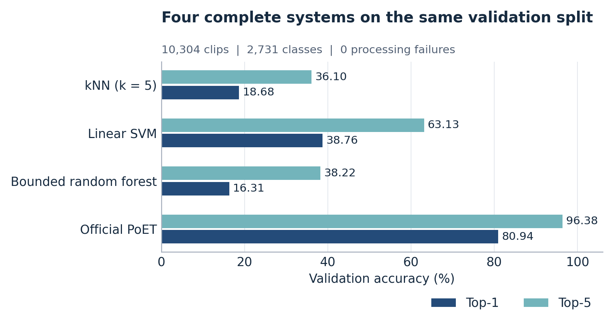
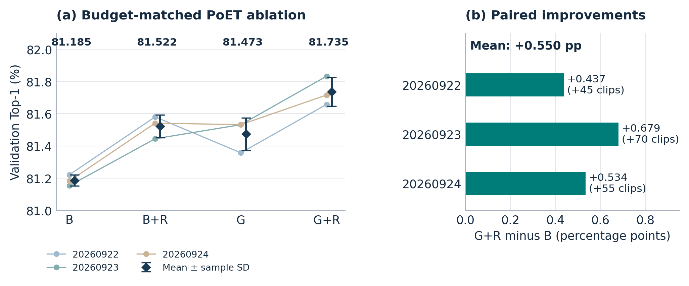
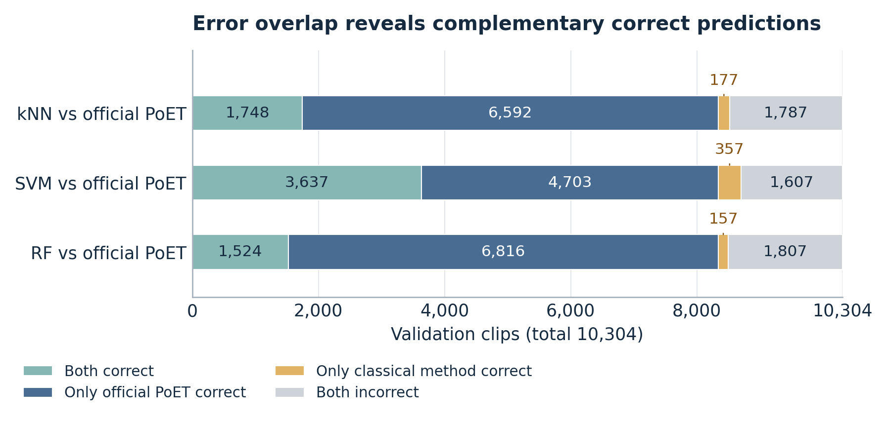

# 孤立 ASL 词语识别：传统姿态描述符与轻量 Transformer 的比较

> 团队报告副本。初稿写于2026-10-04；2026-11-05更新，补入10月12日的一次性最终test评价和之后的补充实验。Git中不收录原视频及图4人物帧；视频画廊与数据需单独获取。下述数字来自原始实验，不代表这份导出代码已重新完成实验。

**EN.601.661 Computer Vision · 最终报告草稿，2026年11月5日**
**本版本由 Xinjie Huang 借助 agent 整理**
项目成员：Xinjie Huang、Duncan Stadler、Leyun Kim、Ming Chen

**版本范围。** 本文对应英文报告，记录 ASL Citizen 官方 training/validation 上的开发实验，以及2026年10月12日对保留 test 的一次性评价。Validation 用于开发和选择；test 只对事先固定的系统评价一次，两者始终分开报告。三位成员各自的方法小节尚待补充，个人贡献段尚未汇总全体成员的最终实际贡献。中文稿供阅读与核对，正式英文稿见同目录 `report-en.md`。

## 1. Introduction｜引言

从视频识别一个手语词，可以支持“演示一个陌生手势，再查找词典条目”的交互。本项目研究的是孤立手语识别：输入是一段已经分好、具有一个词标签的美国手语（ASL）视频，输出是数据集中 2,731 个标签之一。UNDERSTAND 之类的英文名称是类别标签，不是模型生成的英文句子。自然连续视频的词边界定位、句法建模和对话翻译均不属于本项目范围。

ASL Citizen 为这个问题提供了公开数据。Desai 等人发布了来自 52 位参与者的 83,399 段经同意采集的视频，包含不同拍摄环境 [1]。官方划分按照 signer 分离，因此识别训练时未见过的人是重要挑战。数据集论文面向手语词典检索，比较过 RGB 和姿态方法。Lascar 等人提出的 PoET 使用归一化关键点序列和轻量 Transformer 进行孤立词识别 [2]；官方实现与已有 ASL Citizen 权重使我们能够在不新增人工标注的前提下，围绕成熟模型研究小幅改进 [3]。

本项目回答三个问题：第一，在相同固定姿态/运动描述符上，几种简单分类器能做到什么程度？第二，在完全相同的 validation 视频上，它们与已有序列模型相差多少？第三，少量跨部位相对几何信息和固定训练样例检索，能否改善同预算微调的 PoET？前两项属于系统比较，第三项是同一模型内部的受控改动比较。开发结束后，用保留的 test 做一次评价，检查哪些 validation 结论对未见过的 signer 仍然成立。

<!-- BEGIN SOLUTION results-2026-10 -->
随后的补充实验进一步追问传统基线为什么弱：多少来自 signer 之间的左右手差异和原始的受限配置，多少来自描述符本身。
<!-- END SOLUTION -->

已经完成的工作包括公共数据与评价流程，kNN、Linear SVM、受限随机森林三个基线，官方 PoET 部署，同预算微调与几何/检索消融，官方 checkpoint 的镜像测试时增强，一次性最终 test 评价，以及统一视频 demo 和定量、定性错误分析。我们的贡献在于适配、实现、对照实验和解释，不是发明上述分类算法、MediaPipe 或 PoET。Validation 用于开发与选模型；test 结果来自10月12日的唯一一次评价，并单独标注。

## 2. Methods｜方法

### 2.1 数据、预处理与评价

我们保留 ASL Citizen 官方词表和按 signer 分离的划分 [1]，表1数字来自实际发布的 metadata。完整 train 和 validation 视频及 pose 缓存已经准备好，用于开发。Test 视频只用于2026年10月12日的一次性最终评价；其协议在使用任何 test 数据之前固定：事先确定29个系统并全部报告，没有在 test 上做任何选择或调参。没有新增人工标注，也没有删除困难 validation 样本。

**表1：官方数据划分及本文用途。**

| 划分 | 视频数 | Signer数 | 用途 |
| --- | ---: | ---: | --- |
| Training | 40,154 | 35 | 拟合分类器、微调PoET、建立检索库 |
| Validation | 10,304 | 6 | 开发、选择checkpoint和超参数；validation结果 |
| Test | 32,941 | 11 | 一次性最终评价（2026-10-12） |
| 合计 | 83,399 | 52 | 2,731个标签 |

MediaPipe 提供已经训练好的身体、脸和手部关键点提取能力 [4]。传统方法和神经网络复用相同原始检测，但后续表示不同。存在标记将“关键点缺失”和“合法的零坐标”区分开。提取成功只说明产出了可处理记录，不代表词识别正确，也不保证每个点都准确。Validation 有7条视频整段未检测到双手，它们仍包含在分母中。

Top-1 是第一候选正确的视频比例；Top-5 是真实标签出现在实际返回的最多五个候选中的视频比例。Macro Top-1 先计算每个类别的准确率，再对 2,731 类等权平均。因此 instance 指标对应平均视频，macro 指标对应平均类别。比较前检查预测、词表顺序、划分与视频身份；独立重载评价验证保存模型的结果可复现。这种工程复验不是新的统计独立测试。

### 2.2 固定描述符与三种传统分类器

传统系统概括整段动作，不是只识别一张抽帧图片。每帧先形成98个归一化坐标值：双手各20个点相对手腕的 xy 共80维，7个身体点共14维，双手腕相对肩中心共4维。手形使用该视频的典型手掌尺度，身体和手腕使用肩宽。这些是图像平面坐标，不是真实三维测量。有效性规则使缺失组不参与对应均值，并阻止跨缺失帧计算运动差分。

全段、前后两半、四个时间段，共7段的均值构成 7×98=686 维；全段标准差98维、平均有符号相邻变化98维、平均绝对相邻变化98维，以及有效帧/有效相邻帧覆盖率40维，合计1,020维。运动按整段归一化时间表达，不是物理速度。时间金字塔保留粗略先后顺序，但会丢失细致轨迹。StandardScaler 只在40,154条 train 描述符上拟合，然后原样用于 validation 和新视频。构造描述符时不使用 PoET 权重。

**kNN** 使用标准近邻分类思想 [5]。经训练集标准化和每行 L2 归一化后，query q 与训练向量 z 的余弦相似度是 q·z。取最近5个训练样本等权投票，同票时比较最近的支持样本，再按类别ID决定。只返回实际获得票的类别，因此可能不足5个不同标签。项目以 NumPy/PyTorch 实现搜索和投票；它不进行梯度训练，但需要保存训练库，并在查询时计算相似度。

**Linear SVM** 为每个标签拟合一个 one-versus-rest 判别器，以最大 decision value 选择类别。SVM 属于基于间隔的判别方法 [6]；这里学习的是固定描述符上的线性边界，而非直接匹配视频帧。具体使用 scikit-learn 的 LinearSVC：C=0.01、L2正则、squared-hinge loss、dual=False、tol=0.001、max_iter=2000；OneVsRestClassifier 管理2,731个二分类任务。正式run全部收敛。Margin 不是正确概率。

**Random Forest** 组合随机化决策树 [7]。本项目的 scikit-learn 模型使用64棵树，最大深度12，每棵最多256个叶节点，每叶至少2个样本，每次分裂考察约特征数平方根个特征，最后平均各树的类别概率。规模限制控制大词表下的内存，同时也限制容量：实际每棵树都达到256叶上限。SVM与森林使用成熟库 [8]；项目新增视频表示、适配、保存重载和统一评价。三种方法各只有一档有界配置，因此不能将结果当作充分调参后的最佳上限。

补充复现细节：kNN邻居相似度完全相同时，按原训练行号升序排序。

### 2.3 PoET 与相对几何支路

部署的官方 PoET checkpoint 接受128帧、每帧188个坐标值。固定实现的隐藏维度128、2层 Transformer、4个 attention heads，通过 CLS 表示和线性分类器预测标签 [2,3]。预处理包含各部位归一化与官方时长调整规则，训练和评价分别使用记录中的采样模式。四系统比较采用未经本项目微调的官方权重；后面的 B 则专指额外微调后的匹配基线，二者不能混为一谈。

相对几何用于补充各部位分别归一化后可能削弱的空间关系。我们从同一图像坐标系计算7组关系：每只手腕到鼻、嘴中心、肩中心，以及双手腕之间。每组 target−source 位移除以该视频有效肩宽的中位数，记录 x位移、y位移、欧氏长度、存在标记，得到每帧28维。缺失关系置零，没有有效尺度的视频全部几何置零。这些特征不代表物理接触或可靠三维深度。

几何支路为28→32→128的 ReLU MLP，增加5,152个参数，最后一层从零初始化。接入方式可写成：

**修改后帧表示 = 原帧表示 + 有效帧mask × 几何MLP（28维关系）。**

残差在 Transformer 前加入，因此几何信息能够影响后续时序处理。几何与主序列使用完全相同的原始帧索引，避免将某一时刻的手位置配到另一时刻。推理不需要真实词标签或真实属性。

B/G 的3个配对seed分别为20260922、20260923、20260924，均从同一个官方checkpoint开始。每组使用完整train训练10个epoch，batch128，共3,140次优化更新。AdamW的weight decay=0.01，原网络固定学习率0.00003，新增几何支路0.0003；全部原层可训练。采用FP32、相同的已记录时序采样与类别加权交叉熵，无额外空间增强。按完整validation的macro Top-1选择best，包括epoch0，平分时保留较早版本。首个seed参与过早期开发；后两个seed增加重复性证据，但并不是新的独立数据集。

类别加权交叉熵使用 w_c = 1 - n_c / N，其中n_c为该类训练样本数，N为训练总数；不是频数的倒数。

### 2.4 固定检索、镜像测试时增强与演示系统

R 使用每个checkpoint自己的128维CLS向量做后处理，区别于固定描述符上的传统kNN。B或G分别编码完整训练集，建立各自的带标签参考库。对L2归一化的query q和reference z，采用 **K(q,z)=exp[−10×(1−q·z)]**。同一候选类别内先对同一训练signer的样本求均值，再对不同signer等权平均，减轻某位signer参考视频更多造成的支配。

只重排该模型原本的5个候选类别。五个logits转成条件softmax概率，五个检索分数也在候选范围内归一化，然后计算 **0.75×模型概率 + 0.25×检索概率**。该固定规则改变顺序但不新增类别，所以每条视频的Top-5集合及命中率都与对应B或G完全相同。Query真实标签不参与计算。2×2实验复用6个已有checkpoint，没有新增参数训练。

镜像测试时增强（TTA）是另一条无需训练的规则，只用于官方checkpoint：分别对原视频和水平镜像后的视频运行模型，再对两次输出取平均。它不使用标签，是test评价前事先固定的系统之一，没有与B、G或R组合。

浏览器demo接受一段已分好的视频，只提取一次关键点，运行kNN、SVM、森林、官方PoET和一个固定G+R checkpoint。页面区分保存的validation结果与实际重新推理；没有真值的上传视频不展示准确率。票数、margin、树概率和softmax类分数含义不同，不能横向比较成统一可信度。当前demo是离线短片段识别，不宣称端到端实时流式性能。

<!-- BEGIN SOLUTION results-2026-10 -->
### 2.5 传统方法的补充实验：左右手归一化、有界调参与表示替换

10月10–11日的三项补充实验重新考察传统基线，它们都属于test评价前事先固定的29个系统。

*左右手归一化。* 描述符把左右手放在固定位置，因此以左手为主的signer产生的向量，与大多数以右手为主的训练signer不同。一条不使用标签的规则按signer决定：对每段视频，判断左手被有效检测的帧比例是否高于右手，以及左手腕相对肩中心的运动是否大于右手腕。如果某位signer的视频中，左手覆盖占优的比例和左手运动占优的比例都超过一半，就镜像该signer的全部视频。镜像把x变为1−x，交换双手，并交换身体的左右关键点；对这一描述符，它恰好是1,020个值的一个带符号置换。规则只读取无标签的描述符和signer ID，不读取词标签、预测或分数；对validation和test signer，使用的是该signer自己的无标签视频。

*有界调参。* 在归一化描述符上，事先登记的20点网格覆盖三种方法，在validation上评价，每种方法按validation macro Top-1选出一个设置：kNN为k=10加相似度加权投票，SVM为C=0.03，森林为64棵树、最多4,096叶、不限深度。

*表示替换。* 三个分类器保持原始设置，改用PoET的128维CLS向量（PoET自身线性分类头的输入）训练。固定分类器、只换输入，可以把表示的作用和分类器的作用分开。
<!-- END SOLUTION -->

## 3. Results｜结果

### 3.1 完整validation比较

表2全部使用10,304条validation，覆盖所有类别，处理失败为0。SVM在固定描述符组中最好，比kNN高20.0795个百分点。官方PoET识别正确8,340条，SVM为3,994条，macro与instance排名一致。PoET的大幅领先是系统层面的观察：时序表示、关键点选择、预处理、训练历史和开发投入都存在差别，不能全部归因于分类器。

**表2：四个系统在相同完整validation上的表现，准确率单位均为%。**

| 系统 | Top-1 | Top-5 | Macro Top-1 | Top-1正确数 |
| --- | ---: | ---: | ---: | ---: |
| Cosine kNN | 18.6821 | 36.1025 | 19.1649 | 1,925 |
| Linear SVM | 38.7616 | 63.1308 | 39.5262 | 3,994 |
| 受限Random Forest | 16.3141 | 38.2182 | 16.7851 | 1,681 |
| 官方PoET checkpoint | 80.9394 | 96.3800 | 81.1950 | 8,340 |

### 3.2 几何与检索的匹配消融

表3单独报告2×2消融；B是微调PoET，不是表2的官方原权重。G+R相对B平均提高0.5499个百分点，相对G提高0.2620，相对B+R提高0.2135。每一个已观察seed中，G+R的instance和macro都超过两个单项。G+R相对B的逐seed提升为0.4367、0.6793、0.5338个百分点，分别净多答对45、70、55条。

**表3：三个匹配seed的均值±样本标准差，使用百分数刻度；三个seed重复使用相同validation视频。**

| 方法 | Top-1 | Macro Top-1 | 相对B平均Top-1差 |
| --- | ---: | ---: | ---: |
| B：微调PoET | 81.1853 ± 0.0341 | 81.4711 ± 0.0578 | — |
| B+R：检索 | 81.5217 ± 0.0700 | 81.7976 ± 0.1061 | +0.3364个百分点 |
| G：几何 | 81.4732 ± 0.1009 | 81.7451 ± 0.1112 | +0.2879个百分点 |
| G+R：几何与检索 | 81.7352 ± 0.0889 | 81.9937 ± 0.0791 | +0.5499个百分点 |

提升包含改对和改错。以seed20260923为例，G+R纠正B的111条错误，但将41条原本正确的样本改错，净增加70条。Interaction=(G+R−G)−(B+R−B)，平均为−0.0744个百分点，说明收益有重叠，不是超加成。另一个固定checkpoint实验关闭几何残差后，Top-1从81.3568%下降到80.7842%，说明模型依赖这一路输入；关闭已学习支路改变了运行条件，不能取代独立匹配B的比较。

### 3.3 错误重叠与示例视频

虽然总体较弱，SVM能够答对官方PoET答错的357条；反过来PoET答对、SVM答错有4,703条。四法全对461条，四法全错1,428条。这区分了共同难例与不同模型的特有错误。假想的“SVM或PoET至少一个正确”准确率84.4041%需要知道真值后选择正确模型，是oracle诊断上界，不是已实现的融合成绩。

**表4：来自完整validation记录的样例。O为官方PoET；B/G+R为固定seed20260923；index是项目内部validation索引。**

| Index / 真值 | 实际预测 | 记录能支持的解释 |
| --- | --- | --- |
| 11 / UNDERSTAND | 四法均为UNDERSTAND | 共同成功；可见运动模糊未阻止识别 |
| 17 / FINS | SVM:FINS；O:SWEARIN | 传统方法补回错误；FINS为O第二名 |
| 10 / SPECIAL1 | O:CHIMNEY；四法全错 | 共同失败；目标不在O的Top-5 |
| 2312 / INTUITIVE | O:ACCESS；四法全错 | 缓存记录全段双手检测均为0 |
| 59 / KICK2 | B:BRIDGE1；G+R:KICK2 | 相对匹配基线改对 |
| 0 / SUPPORT1 | B:SUPPORT1；G+R:CABINET | 相对匹配基线改错 |

Gallery以固定规则选取16例，每例抽取25%、50%、75%时刻的3帧，共48帧，覆盖全对、全错、传统方法补回、仅PoET正确和缺手检测。这是教学展示，不是随机准确率抽样。视觉检查将实际可见的位置、模糊、取景与机制假设分开；不能仅凭几张静态图判断ASL语义或出错原因。

分组结果也有差异。排除只有2条视频的signer后，官方PoET各signer Top-1介于69.95%和85.67%。双手平均检测比例大于0且低于25%的组为78.10%，至少50%的组为84.64%。此比例是左右手检测次数之和除以两倍解码帧数，不是“至少一只手可见”的帧比例。单手词、静止帧、signer和类别分布都会混杂这些关联。7条整段未检测到手的视频全错，但即使全部改对，总体也只增加至多0.0679个百分点。

*图4：真实validation视频在约25%、50%、75%时刻的画面。UNDERSTAND为共同成功，PARADE为共同失败；匹配seed20260923下，G+R改对KICK2但改错SUPPORT1。a-b使用官方PoET，c-d使用匹配微调B与G+R。标签来自数据集；这些按正确性选出的例子不能证明错误原因，也不是准确率估计。*

本代码仓库未收录原始人物图像面板。

### 3.4 一次性最终test（2026年10月12日）

表5给出四个原始系统、镜像TTA和匹配PoET消融的test结果。每个test分数都来自对事先固定系统的唯一一次评价；validation分数一并列出以便对照。官方checkpoint的test Top-1为73.56%，与PoET论文报告的73.54% [2] 相差不到0.02个百分点，这检查了我们在test signer上的数据与pose流程。

**表5：validation与一次性test结果，单位为%。B至G+R为三个匹配seed的均值；“—”表示未报告。**

| 系统 | Validation Top-1 | Test Top-1 | Test Top-5 | Test Macro Top-1 |
| --- | ---: | ---: | ---: | ---: |
| Cosine kNN，k=5 | 18.68 | 15.52 | 30.67 | 15.61 |
| Linear SVM，C=0.01 | 38.76 | 30.93 | 52.23 | 31.06 |
| 受限Random Forest | 16.31 | 12.54 | 30.10 | 12.56 |
| 官方PoET checkpoint | 80.94 | 73.56 | 92.60 | 73.54 |
| 官方PoET + 镜像TTA | 82.25 | 74.72 | 93.34 | 74.72 |
| B：微调PoET | 81.19 | 73.45 | 92.47 | — |
| B+R | 81.52 | 73.87 | 92.47 | — |
| G | 81.47 | 73.76 | 92.61 | — |
| G+R | 81.74 | 74.18 | 92.61 | — |

所有系统在test上都低于validation。PoET各系统和SVM下降7.4–7.8个百分点；kNN和受限森林起点更低，下降3.2–3.8个百分点。部分下降在预期之内：validation被反复用于开发与选择，test signer也是另一批人。四个原始系统的排名不变。

匹配收益在test上仍然成立。G+R比B高0.74个百分点（三seed t区间[+0.54, +0.93]；按11位test signer的bootstrap区间[+0.58, +0.89]），G、R和G+R相对B的提升在三个seed上都为正。与validation一样，R不改变Top-5。B本身在test上比官方checkpoint低约0.1个百分点，而在validation上高约0.25个百分点；可见只做微调、并按validation选checkpoint，在test上没有超过官方权重。

镜像TTA使官方checkpoint提高1.17个百分点，11位test signer全部提升。官方PoET加TTA是表5中test Top-1最高的系统（74.72%），高于G+R（74.18%）。但两者起点不同（官方权重与微调后的B），TTA也没有与G+R组合，因此不能据此说明哪一种改动更好。由于test已经使用过，任何组合系统今后都只能在validation上开发和报告。

<!-- BEGIN SOLUTION results-2026-10 -->
### 3.5 传统方法的补充实验

表6报告2.5节的补充实验。归一化规则镜像了6位validation signer中的2位，以及11位test signer中的3位。

**表6：传统方法补充实验，Top-1，单位为%（kNN / SVM / RF）。“归一化”指左右手归一化后的描述符；调参设置在validation上选出。**

| 系统 | Validation | Test |
| --- | ---: | ---: |
| 原始描述符与原始设置 | 18.68 / 38.76 / 16.31 | 15.52 / 30.93 / 12.54 |
| 原始设置，归一化描述符 | 20.23 / 43.87 / 17.94 | 16.15 / 35.76 / 14.84 |
| 调参设置，归一化描述符 | 20.53 / 52.47 / 35.55 | 16.34 / 42.52 / 28.22 |
| 调参设置，原始描述符 | 18.97 / 47.03 / 32.39 | 15.52 / 37.32 / 24.84 |
| 原始设置，PoET的128维CLS向量 | 79.16 / 69.91 / 25.84 | 71.94 / 64.11 / 20.93 |

归一化对SVM帮助最大：test上提高4.84个百分点，其中3位被镜像的signer提高13.8个百分点，其余8位只提高1.5个百分点。再调C（validation网格从0.001到0.1，C=0.03最好）又提高6.76个百分点，达到42.52%。两步在test上都显著（McNemar p < 1e-130）。C=0.1时，2,731个二分类问题中有280个在2,000次迭代后仍未收敛。

森林因叶数预算增大而在test上提高13.4个百分点（McNemar p < 1e-300）。原始森林的64棵树全部恰好用满256叶、深度达到12；放到4,096叶后每棵树仍然用满预算，所以这还不是森林的上限。调参后的森林训练约需37 GB内存，模型文件11.5 GB，因为每个节点都存储全部2,731类的分布。

kNN几乎没有变化：10个validation设置都在19.7%到20.5%之间，选出的设置并不显著更好（McNemar p = 0.25）。

最好的传统系统（归一化描述符上调参后的SVM）在test上仍比官方checkpoint低31个百分点。固定分类器及其原始设置、只把归一化的手工描述符换成PoET的CLS向量，SVM与官方checkpoint的差距缩小约75%，kNN缩小约97%：CLS上的kNN达到71.94%，只比PoET自己的线性分类头低1.6个百分点。原始森林从更好的输入中获益少得多（20.93%），与其较小的叶数预算一致。
<!-- END SOLUTION -->

## 4. Discussion｜讨论

### 4.1 实验支持什么

在同一描述符下，SVM说明学习到的判别边界比当前余弦距离或受限森林更有效地使用这些摘要；不能推广为线性SVM在所有姿态表示上都最好。森林达到叶数预算，粗粒度时序池化也可能合并不同轨迹。特征审计确认值有限、标签对齐、train-only标准化正常、行数完整，所以低分不能简单解释成文件缺失；这些检查也不证明所有特征设计都最优。

<!-- BEGIN SOLUTION results-2026-10 -->
补充实验让这一判断更清楚。传统方法与PoET的差距有一部分来自可以避免的设置：描述符中左右手位置固定、SVM正则过强、森林叶数预算受限。修正后，最好的传统系统test成绩从30.93%提高到42.52%。剩下的差距主要来自表示：固定分类器时，PoET学到的表示承担了大部分作用，在其上做近邻投票就与PoET自己的分类器只差1.6个百分点。因此，在手工描述符上SVM领先kNN，更多说明的是各分类器如何应对较弱的表示，而不是分类器本身的一般优劣。
<!-- END SOLUTION -->

PoET提供了强得多的参考系统。匹配消融支持更具体的贡献：在已经测试的预算内，显式图像平面相对关系与固定检索带来小幅收益。在validation上，收益方向一致，但用的是开发数据；在保留的test上收益仍然成立：G+R比B高0.74个百分点，每个seed都为正，按signer的bootstrap区间也在0以上。目前仍没有“参数量相近但只使用原输入”的支路对照，因此不能把收益唯一归因于新增几何信息而排除额外容量因素。Test区间描述的是这三个seed和11位test signer，不是对所有未来signer或数据集的保证。

另外两项test观察需要一并说明。单独微调（B）没有超过官方权重，因此匹配收益是相对一个本身并不比发布模型更好的基线。无需训练的镜像平均给官方checkpoint带来的提升（+1.17）也大于几何与检索给B带来的提升（+0.74）。最简单的改动在test上效果最好，不过两者从未组合，也不是从同一起点比较的。

### 4.2 与既有工作的关系及无明显收益的尝试

我们沿用ASL Citizen的孤立词典检索任务 [1]，适配现成PoET [2,3]。在官方test上，我们的官方checkpoint Top-1为73.56%，与PoET论文报告的73.54% [2] 相差不到0.02个百分点。数据集论文在同一批held-out test signers上报告约63%的识别准确率与91%的recall@10 [1]；本文基于PoET的系统超过这一数字，主要是PoET本身的作用，而不是我们的改动。使用官方checkpoint也不等于重做了论文全部训练搜索、全部数据集或在线用户研究。本项目的价值是可追溯比较与有限模型改动，不是宣称新的SOTA。

更复杂的改动并未自动带来更好结果。属性辅助监督最初只比匹配基线多答对4条，增大新头学习率后只多2条。跨signer监督对比学习为81.0850%，匹配分类控制为81.1141%。将B/G训练延长到20epoch后，几何平均优势由0.2879降为0.2588个百分点。随后一个seed的手部RGB时序融合达到81.8517%，相对同seed已有G+R的81.8323%只多2条，而且将底层G的Top-5从96.5450%降至96.1277%。这些结果支持保留较简单的几何/检索候选，而不是把计算复杂度当成进步证据。这些探索方向都没有在test上评价。

### 4.3 局限与后续工作

最主要的风险是validation被反复用于开发。Checkpoint选择、设计修改和其他探索可能偏向这批样本，首个seed还参与过调参。一次性test评价显示了这一影响的大小：PoET各系统和SVM从validation到test下降7–8个百分点，而匹配的G+R收益仍然保留。Test已经使用过一次，今后不再使用。任何进一步的改动，例如把镜像TTA与G+R组合，都只能在validation上开发和报告，并标注为validation结果。三个seed和11位test signer作为不确定性估计的基础仍然偏少。

<!-- BEGIN SOLUTION results-2026-10 -->
传统方法的补充实验还有两点局限。左右手归一化按signer、用该signer自己的无标签视频做决定，因此假设signer已知且有多段视频；它不泄漏标签，但属于signer层面的适配，对单段上传视频的效果没有评价。调参设置在validation上选出；唯一一次test评价确认了收益，但不说明所选数值就是最优。调参后的森林训练需要约37 GB内存，没有大内存机器时并不实用。
<!-- END SOLUTION -->

ASL Citizen之外的泛化也尚未测量。当前词表封闭、词边界由输入提供，新上传视频的取景、动作风格或词表覆盖可能不同。系统目前总返回候选，没有经过验证的未知词拒识机制。以后可单独研究置信度校准与拒识、新signer条件下的评价，以及不那么保守的身体mask、稳健运动摘要，但均需新对照。目前没有在统一硬件和测量条件下完成所有方法的成本benchmark，因此不以零散耗时为速度排名。不同模型可以补回错误，说明存在互补潜力；真正学习选择器仍需独立开发数据，不能事后按真值挑选正确模型。

## 5. Conclusion｜结论

本项目完成了四种孤立ASL识别系统的可复现比较，以及PoET的受控适配。在完整validation上，官方PoET Top-1为80.94%，原始固定描述符中最好的Linear SVM为38.76%；在一次性test评价中，两者分别为73.56%和30.93%。相对几何与固定检索将匹配微调PoET的三seed平均成绩在validation上从81.19%提高到81.74%，在test上从73.45%提高到74.18%。这一收益较小，每个seed都为正，也包含退化样本。对官方checkpoint做无需训练的镜像平均，得到最高的test Top-1，为74.72%。完整分母、负结果、错误重叠和可运行的视频界面，使项目证据超出一项有利分数。

<!-- BEGIN SOLUTION results-2026-10 -->
传统基线的补充实验表明，左右手归一化和有界调参把最好的传统系统test成绩提高到42.52%，但仍比PoET低31个百分点。只把输入换成PoET的表示，kNN和SVM的大部分差距就消失了。传统系统与PoET的主要差别在于表示，而不是分类器。
<!-- END SOLUTION -->

**本版本贡献说明。** Xinjie Huang发起并指导实现与实验工作、确定项目范围，借助coding agent和写作辅助整理本报告。Agent在他的监督下完成或协助数据准备、模型适配、训练评价基础设施、结果验证、demo及分析初稿。10月10–12日的补充实验和一次性test评价属于同一项工作；11月5日的更新在agent协助下把这些结果补入本报告，没有运行新实验。Xinjie负责审阅并解释最终提交材料。Duncan Stadler、Leyun Kim和Ming Chen将各自重新实现并分析一种传统方法，他们的方法小节和实际贡献将根据这部分工作补充；不能仅因为某个参考基线存在，就把它归为某位队友已经完成。最终提交前，贡献段应按实际工作更新，项目保留实验和AI使用记录供核查。

## References｜参考文献

[1] A. Desai, L. Berger, F. O. Minakov, V. Milan, C. Singh, K. Pumphrey, R. E. Ladner, H. Daumé III, A. X. Lu, N. Caselli, and D. Bragg. **ASL Citizen: A Community-Sourced Dataset for Advancing Isolated Sign Language Recognition.** NeurIPS 36, Datasets and Benchmarks, 2023. [论文](https://papers.nips.cc/paper/2023/file/f29cf8f8b4996a4a453ef366cf496354-Paper-Datasets_and_Benchmarks.pdf).

[2] J. Lascar, J. Françoise, M. Gouiffès, A. Braffort, and D. Fabre. **PoET: Lightweight Pose Encoder Transformer for Online Sign Language Recognition.** VISAPP 2026, vol. 1, pp. 19–28. [DOI:10.5220/0014237500004084](https://doi.org/10.5220/0014237500004084).

[3] J. Lascar et al. **PoET: Official Implementation and Pretrained Weights.** 官方代码，revision dca74c30d9d604cb3b92de8fc73ce91484644259，2026. [仓库](https://gitlab.lisn.upsaclay.fr/mtals/publications/poet).

[4] I. Grishchenko and V. Bazarevsky. **MediaPipe Holistic—Simultaneous Face, Hand and Pose Prediction, on Device.** Google Research, December 10, 2020. [技术说明](https://research.google/blog/mediapipe-holistic-simultaneous-face-hand-and-pose-prediction-on-device/).

[5] T. M. Cover and P. E. Hart. **Nearest Neighbor Pattern Classification.** IEEE Transactions on Information Theory, 13(1), pp. 21–27, 1967. [DOI:10.1109/TIT.1967.1053964](https://doi.org/10.1109/TIT.1967.1053964).

[6] C. Cortes and V. Vapnik. **Support-Vector Networks.** Machine Learning, 20, pp. 273–297, 1995. [DOI:10.1007/BF00994018](https://doi.org/10.1007/BF00994018).

[7] L. Breiman. **Random Forests.** Machine Learning, 45, pp. 5–32, 2001. [DOI:10.1023/A:1010933404324](https://doi.org/10.1023/A:1010933404324).

[8] F. Pedregosa et al. **Scikit-learn: Machine Learning in Python.** Journal of Machine Learning Research, 12, pp. 2825–2830, 2011. [论文](https://www.jmlr.org/papers/v12/pedregosa11a.html).
